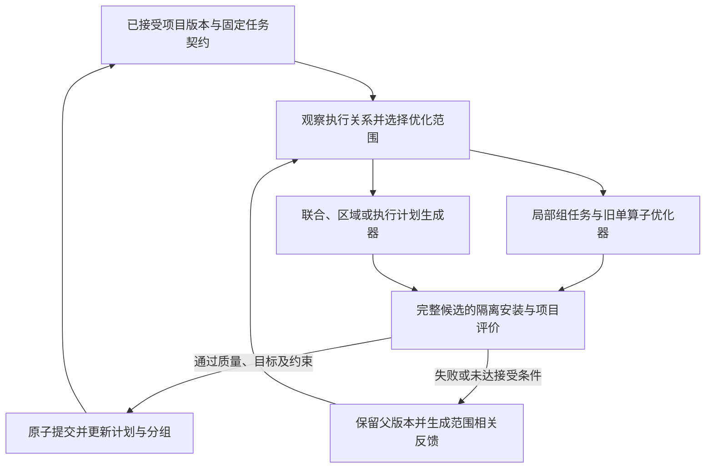

# v6 通用 C3 工作流与通信资源集成实施计划

日期：2026-10-20。代码基线：`v5-C3@8de73b4f673a82f277dac539f04aa7da4ae25f70`。开发分支：`v6`。

执行状态（同日 17:34）：P0–P6 在 box4-2 当前硬件上的主线实现与验收已完成，详见[逐项证据及边界](v6-acceptance.md)与[执行记录](v6-execution.md)。本文保留准备阶段的事实和实施要求；“待实现”等历史表述不替代当前验收状态。计划中延后的 TP2 与其他互连硬件扩展仍单独列明。

本阶段交付的是从项目入口和目标出发、能够执行并迭代的 C3 工作流：理解项目与目标，生成和验证评测，建立执行关系与动态分组，按目标分配优化预算，生成单组、多组联合、计算区域或执行计划候选，原子回装，评价项目效果，再向对应优化 Agent 返回可行动的反馈。优化对象是固定任务契约内的整个项目执行过程；算子组是可调整的搜索与反馈粒度。通信作为按任务和环境启用的资源信息加入同一流程。旧单算子任务继续走原有默认路径。

核心实现选择是新增项目协调层和适配层，复用已有搜索、资源响应、候选制品与绑定能力；将 profiler 拆为独立采集器和分析器。模型名、GPU 型号、目标名字、站点路径及实验目录不进入通用控制逻辑。性能改善必须由真实工作负载证明，通信量下降本身不构成接受条件。

## 1 调研结论与开发环境

### 1.1 本次基础准备

本地新工作树为 `D:\Pyhon_projects\opop\v6`，远端新工作树为 `/root/autodl-tmp/dev/opop-v6`，两者均从上述提交创建 `v6` 分支。保留原 `v5-C3` 工作树及历史实验树。服务器私有工作目录为 `/root/autodl-tmp/dev/v6-work`，配置、运行产物、OpenCode 数据和缓存与旧实验分离。

解释器复用 `/root/autodl-tmp/dev-venv/bin/python`。它的 editable 安装仍指向原开发树，因此 v6 启动器显式设置 `PYTHONPATH=<v6>/src:<v6>`；实验入口必须检查实际导入位置，不能仅凭当前工作目录判断版本。后续运行使用不可变源码快照，包含 `src`、`examples`、`scripts`、所需配置和任务文件，不沿用只复制部分目录的旧 C3 快照脚本。

现有 provider 配置已在服务器内复制到隔离工作目录，权限为 `0600`，继续使用 `zhipuai/glm-5.3`；模型选择和凭据都属于部署配置，不写入算法默认值或提交到 Git。真实调用、GPU 采集与原始日志位置见[本次预检记录](v6-box42-preflight-20261020.md)及[机器可读回执](evidence/v6-preflight-20261020/summary.json)。

### 1.2 box4-2 的当前能力

| 项目 | 2026-10-20 实际核查 | 对实现的约束 |
|---|---|---|
| SSH | `connect.bjb1.seetacloud.com:30726`，密钥登录成功 | 使用已验证 host key；旧 box4 的 37752 端口不是当前入口 |
| GPU | 2 × RTX 4090，各 24564 MiB，driver 580.105.08 | 按 GPU UUID 分配资源；双卡任务须同时获得两卡使用权 |
| 进程可用资源 | cgroup 内存上限 240 GiB，CPU quota 相当于 32 核 | 不能用宿主机显示的约 1 TiB 内存和 128 个逻辑 CPU 制定编译预算 |
| 软件 | Python 3.12.4，torch 2.13.0+cu129，CUDA runtime 12.9，NCCL 2.29.7，Triton 3.7.1，Transformers 5.16.1 | 记录实际版本及依赖能力，不用在线最新版 API 假定本机支持 |
| CUDA 编译器 | nvcc 12.8.93 | toolkit、torch runtime、driver 分别记录，不合并成一个 CUDA 版本 |
| 拓扑与 P2P | GPU 间 `NODE`；读写均 `CNS`；双向 CUDA peer access 为 false | 本机不启用 peer-memory 实现；没有 NVLink 测量条件 |
| 实际 NCCL 路径 | 新 all-reduce 作业通道为 `SHM/direct/direct` | 不能由 `direct`、网络初始化日志或可见 NIC 推断实际 GPU P2P／RDMA 传输 |
| 时间线 | PyTorch CPU/CUDA profiler 与 Nsys CUDA/NVTX 实测可用 | 作为首批通信观测后端 |
| 硬件计数器 | NCU 与 Nsys GPU Metrics 均实测 `ERR_NVGPUCTRPERM` | 返回权限不足状态；不阻断基础工作流，也不伪造零值 |
| PCIe | `nvidia-smi dmon -s t` 在短通信负载中有非零读数 | 只能作为设备级、秒级速率，不能直接归因到微秒级算子 |
| 扩展工具 | Nsys 2025.3.1；当前帮助未列出 `nccl` trace；PATH 无 dcgmi／all_reduce_perf | 不自动要求安装或升级；按已安装工具能力选择采集路径 |
| 存储 | 核查时数据盘约剩 73 GiB，系统盘约剩 28 GiB | 每轮记录空间；trace、编译缓存与模型资产分开管理 |

### 1.3 通信实验的可复用内容与边界

已重新核查备份 ZIP 的 CRC 和清单哈希，以及远端五组 `SHA256SUMS` 的 207 个文件和最初通信 manifest 的 174 个文件，共 381 项。另检查了实验源码、JSON 数值和已有 SQLite 中的 NCCL 记录。历史记录保持原样；这些手工实验没有被当成当前框架自动化能力。

| 历史实验 | 已有证据 | v6 中的用途 |
|---|---|---|
| 通信能力与 Nsys | 独立双 rank profiler、真实 NCCL 通道、时间线区间与 PCIe 样本 | 提取采集和解析方法，去除固定机器、rank 数和路径；扩展到真实 Agent/helper/worker 生命周期验证 |
| GPT-2 DDP 累积 | 标准 `no_sync` 将中位步时间 254.237 ms 降至 231.671 ms，梯度及更新参数通过比较 | 作为训练语义和通信事件回归案例；正式比较以正确使用 `no_sync` 的实现作为合格基线 |
| Qwen3 TP2 | 真分片；每 forward 73 AllReduce 与 1 head AllGather | 验证分布式图、collective 归属与替换边界；数量由 trace 得出，不能写入通用实现 |
| TP2 对单卡质量 | NRMSE 0.012922229 高于 0.01，greedy 仅 10/16 匹配 | 保留为未解决的基线质量问题；不允许在优化后静默放宽或跳过 |
| add 与 RMSNorm 融合 | 对冻结 TP 基线通过；通信次数不变；短测结果波动 | 回归真实局部 kernel 的安装和数值语义，分类为计算优化 |
| 分布式 greedy 选择 | head 逻辑输入 151936→8 B/rank，仍为一次 AllGather；端到端中位耗时约增加 2.04% | 重要负例：必须把通信减少与项目指标退化同时送给组 Agent；仅适用 greedy-token contract |

上述历史实验不作为 v6 的预置答案。通用框架不能根据模型名直接选择 RMSNorm、greedy 或 `no_sync`。greedy-only 输出与 full logits／logprobs 的要求必须由契约明确区分。

## 2 范围与完成定义

首期运行支持以 Python 入口执行的 PyTorch 项目、单机单卡及单机多卡任务。支持可封装的 module、functional 计算区域及显式分布式通信区域；遇到不能可靠捕获的动态控制流、外部自定义 runtime、跨节点时钟或不可恢复状态时，输出具体能力缺口，不生成虚假的分组和测量结果。

通用性由稳定接口、数据驱动的任务和能力探测保证，不要求首版声称覆盖任意语言、任意编译图或任意并行框架。训练工作流通过单独的状态适配器接入，DDP 是梯度、优化器状态及跨步语义的验收实例。

项目模式必须覆盖同一项目的多个组，以及具有合法外部边界的联合改写。首期执行计划候选可以涉及布局与中间转换、缓冲区／缓存生命周期、执行顺序、通信组织和计算通信重叠；具体允许的编辑由任务契约、依赖证据和适配器能力共同决定。只对已验证场景承诺语义与性能，不能凭一次 trace 任意重排整张动态图。执行计划候选也必须保持固定输入、输出要求、有效 batch、精度及质量标准；既有计时范围仍然有效，不能将新增开销移到测量窗口外。

最终验收同时满足：

1. 用户提供项目、入口、目标和必要输入，无需人工准备 profile、target、组列表、替换 glue code 或专用 evaluator。
2. 自动生成并执行验证任务契约、适配器、评测与采集计划；记录推断字段及依据。
3. 发现多个合法组和区域，按目标和测量证据选择；接受改动后支持重分组，并输出未选择／不能替换的原因。
4. 真实 Agent 生成候选，真实 GPU／NCCL 执行候选，检查实际覆盖、正确性和项目指标。
5. 后续真实 Agent 调用消费上一轮的组级反馈；证明反馈实际进入请求，不能只有落盘文件。
6. 单卡任务不强制初始化 distributed；多卡通信按实际需求和可用字段启用。
7. 旧输入保持原默认行为；更换任务、组名、目标或采集后端不需要修改通用控制代码。
8. 至少通过两个不同结构项目和一个未预注册入口的验收，其中包含非 Qwen 项目与真实双卡任务。任何无收益或失败结果如实保留；工作流正确性不以强行得到正收益为条件。
9. 在同一项目测试版本中同时安装并执行至少两个组的自动候选，验证组合覆盖、质量、项目评价和回退；是否发布为接受版本由真实收益及约束决定，不能直接累加单组收益。
10. 至少真实运行一个需要联合修改边界的候选和一个改变执行计划的候选，验证整体合法性、原子安装、反馈及故障恢复。协议允许它们是同一候选，但须分别提供两项能力的证据；不能要求每个子编辑单独合法或单独加速。

跨节点执行、NVLink/RDMA 的实机验收、大规模训练、自动改变 TP 度数及复杂并发搜索作为后续扩展。本次 box4-2 只能实证当前拓扑；其他互连的接口支持、离线解析通过和真实硬件验收分别标记。

## 3 模块边界与复用方式

通用类型层不导入 torch、Nsys 或 OpenCode。协调器只依赖协议；项目和后端相关代码放在适配器中，采集器输出统一观测模型，分析器只读取观测和原始证据引用。策略、prompt、工具后端及默认配置分别版本化。

| 模块与拟议位置 | 责任与主要接口 | 可复用的当前代码 |
|---|---|---|
| `models/project_*` | ProjectRequest、ExecutionPlan、GroupRegistry、OptimizationTask、ProjectRevision、Feedback；引用现有任务和评测类型 | `models/task_bundle.py`、`evaluation_bundle.py`、`resource_axis.py` |
| `project/adapters/` | `prepare/run/reset/bind/restore/capture`；项目输入、状态、输出、设备布局及允许的计划编辑 | 提取 Qwen runner 和 binding 的通用部分；Qwen 留作适配器 |
| `project/workflow.py` | 项目协调、阶段调度、主版本与探索分支、预算、恢复及终止 | 保留旧 Orchestrator；新入口单独组装 |
| `project/discovery/` | 调用目录、执行依赖、语义边界、动态组／区域及版本对应关系 | `device_profile.py`、`fast_target.py` 的可泛化逻辑 |
| `project/selection/` | shortlist、单组与联合试探、目标收益排序、区域扩展、重选 | `fast_sites.py` 的规则与证据概念，不继承固定 GoalId |
| `project/group_runner.py` | 将组适配为单算子任务，传递资源响应，返回候选集合 | 旧 tuner、分析、重写组件；`TaskSearch`／`run_rewrites` 的明确执行模式 |
| `project/candidate_runner.py` | 按 scope／能力路由 OptimizationTask；组织联合、区域及执行计划候选 | 复用 group_runner 和候选生成接口；不强迫执行策略适配为单 kernel |
| `project/transactions.py` | 编辑影响闭包、冲突检查、隔离安装、全 rank 验证、版本提交与回退 | bundle、snapshot、worker 与 RunStore 的组合，不修改旧绑定默认行为 |
| `profiling/collectors/` | `probe/collect/normalize/validate`；各工具独立实现 | `LightProfiler`、CUDA trace、外部通信 probe 方法 |
| `profiling/analysis/` | 事件关联、区间计算、组反馈和跨 rank 诊断 | 外部 Nsys SQLite 分析；统一处理缺测与覆盖 |
| `runtime/` | 本地／分布式 worker、GPU 使用权、超时、进程组回收、采集器生命周期 | GPU worker 的执行设施；新增成组的 rank 管理 |
| `artifacts/` 与 `store/` | 内容哈希、源码快照、引用、版本图、事件及脱敏导出 | candidate bundle、project snapshot、RunStore |
| `agents/` | 项目理解、评测生成、分组语义判断、选择、局部优化和执行计划提案 | EvalBuilder 与现有优化 Agent；按角色注册，不要求每步都有独立模型进程 |

新增 schema 必须有版本和显式兼容转换。现有 `ResourceObservation.value` 是必填数值，不直接改成可空并影响旧消费者；新采集回执用外层状态包裹可选 observation，只有成功的数值观测投影到旧类型。

注册表首版采用显式 Python provider 注册及配置选择，不引入复杂插件安装系统。每个实现声明支持的协议版本、依赖、能力探针、采集成本和互斥资源。替换 Nsys 解析器或增加一个通信字段，不应修改 workflow、旧 Orchestrator 或已有 Agent 的业务逻辑。

## 4 输入契约与持久化制品

### 4.1 项目请求

新增 `optimize-project` 入口。用户输入包括源码位置、入口及启动参数、目标自然语言、输入／数据集引用、设备约束、预算和必要质量要求。已有正式 workload／quality 配置可以直接引用，不要求重复生成。

项目理解 Agent 读取真实源码和启动信息，生成结构化 TaskDefinition 及 adapter 候选。metric、方向、单位、完成条件、工作负载分布、输入引用、状态重置、输出要求、质量检查与预算在搜索前固定。未给出且不能由项目确定的语义必须报告缺失；Agent 不能自行降低输出要求、改变有效 batch 或缩短生成长度来得到收益。

目标不枚举为 `ttft/single/multi`。这些是可声明的目标实例；可以新增尾延迟、每步时间、tokens/s、指定阶段延迟或通信预算约束。通信资源可作诊断、约束或显式目标，角色必须在 contract 中注明。

### 4.2 最小制品集合

| 制品 | 必需内容 |
|---|---|
| TaskDefinition / EvalBundle | reference、输入、目标、质量、状态、协议、评测入口及控制样例 |
| CapabilityManifest | 可见设备、进程布局、拓扑、工具版本、字段可采性、探针与覆盖证据 |
| ExecutionPlan | 版本化的调用／区域、场景与 guard；数据、控制、alias／状态、stream／event、collective 和消费依赖；未知依赖及证据来源 |
| TraceCatalog / GroupRegistry / GroupSpec | 稳定调用身份、组版本、场景、输入输出、语义和状态；组的合并／拆分／退役关系、重叠站点、冲突与依赖 |
| SelectionDecision | 目标和父版本、scope、组／区域／计划编辑、影响闭包、单组或联合试探证据、预算、选择及排除原因 |
| GroupTask | reference、真实 fixture、支持场景、资源观测、合法修改范围、返回 ABI、项目父版本 |
| OptimizationTask | scope、外部语义契约、执行计划和组版本、可编辑范围、联合依赖、参考运行与测量入口；局部子任务可复用 GroupTask |
| CandidateBundle | 代码／计划编辑、参数、入口、scope、涉及组与调用、代码／状态读写范围、内部 ABI 和外部契约、guard／fallback、rank 协议、依赖／互斥、父版本及内容哈希 |
| EvaluationReport | 整体及可合法拆分子项的质量、项目指标、原始基线约束、配对样本、资源、覆盖、成本、接受／拒绝及证据 |
| GroupFeedback / ProjectFeedback | 组与联合候选身份、本组／边界／计划前后对照、整体收益、交互证据、邻居／collective、失败及不可归因项 |
| ProjectRevision | 父版本、源码／执行计划／组注册表快照、完整 bundle 集及依赖、继承／替代／退役关系、事务与接受记录；`group → candidate` 仅为派生视图 |

所有性能和反馈记录关联源码快照、contract、workload、设备及 rank 布局、候选参数、测量协议和采集器版本。只记录 Git HEAD 不足以标识未提交代码；快照须记录逐文件哈希。源码、provider 配置、模型资产、运行证据分别存储。

ExecutionPlan 是可复核的执行关系描述，允许部分覆盖和未知依赖，不要求先把所有项目转换为单一静态编译图。运行证据、源码推导和 Agent 假设分开存储；不能跨越尚未验证的数据／状态／同步依赖进行重排。共享状态、缓冲区和 collective 可关联多个组，不强行压成单一归属。

### 4.3 优化范围与候选协议

以下 scope 与候选实现类型分开编码：scope 表示一起改变的范围，kernel／library／composite／distributed／strategy 表示采用的实现方式。

| scope | 候选范围 | 必须明确的边界 |
|---|---|---|
| `group` | 一个语义组的合法调用集合 | 支持场景、局部 ABI、共享实现与实际替换覆盖 |
| `joint` | 多个组或编辑项组成一个不可拆分的候选 | 联合读写与依赖闭包、内部接口变化、外部不变量 |
| `region` | 可封装计算区域，允许跨原组融合、拆分或消除中间步骤 | 区域入口／出口、所有外部消费者、alias／状态、动态 guard |
| `execution_plan` | 项目中允许的布局、缓存、调度、通信组织等执行策略编辑 | 计划前后差异、影响到的调用／组／rank、生命周期及完成条件 |

用户可以只提供项目与目标，由协调器选择范围；无需人工填写组列表。适配器声明支持的 scope 和可验证编辑，协调器将请求范围、契约和能力求交并记录限制原因，显式要求的必需能力不满足时返回缺口。项目模式允许四种 scope，实际探索受预算限制；关闭联合探索的受控对照可以只允许 `group`。

新项目配置命名为 `project_search.allowed_scopes`、`project_search.strategy=bounded_joint|sequential`，声明联合编辑宽度、区域规模、计划编辑数及活动分支数。这里的有界指同时探索的结构规模，不是开发 Agent/API 的费用、调用量、token 或运行时长上限。开发模式使用 `usage.mode=observe_only`，只记录完整会话用量；不得因累计用量终止开发、自动降级模型或缩减验证。正式对照实验另用显式实验协议约束搜索试探和 GPU 采样，以保证比较口径一致，不把该协议传播为开发 Agent/API 限额。阶段能力缺失须显式记录；联合编辑宽度不能作为执行计划最多影响几个组的隐含上限。旧入口不解析或启用这些项目策略。

所有范围共用固定的 TaskDefinition／EvalBundle。候选可以改变声明范围内的内部布局和实现接口，外部语义仍须等价；若改变了一个中间接口，其全部受影响消费者必须进入编辑闭包或提供计入测量的合法转换。超出 guard 的输入须整体回退到兼容父版本或按契约明确拒绝，不允许半新半旧的区域混合执行。

## 5 自动工作流

### 5.1 建立并验证评测

项目理解与 EvalBuilder 生成 adapter 和项目相关 glue code，框架提供计时、资源采集、替换安装及结果校验库。候选不能修改已固定 evaluator、reference、质量阈值或计时范围。

生成后必须执行原项目、identity replacement、错误输出负控制、未执行候选的覆盖负控制，以及状态 reset 的重复检查。分布式任务还检查每个 rank 加载一致 bundle、完整参与和失败后退出。失败进入由真实错误驱动的生成修复循环，开发阶段不施加 Agent/API 用量额度；编译成功不算 evaluator 完成。

搜索、诊断和最终保留集分开。采集为诊断增加的同步、hook 和日志默认不进入正式性能测量；必要的原生完成等待属于 workload 契约的一部分。

### 5.2 发现与分组

首先在目标 workload 下运行，获取 module、functional 调用、shape/layout、状态和 collective 信息。不能只从源码枚举未执行模块，也不能把一次 trace 当全部输入场景覆盖。

组身份与目标权重分离。组内共享实现须兼容数值语义、输入输出结构、dtype/layout、标量属性、副作用、alias 和状态；形状可按支持范围或分桶表达。目标权重来自各阶段和场景的真实调用分布。

Agent 可提出融合边界和语义分组，框架验证边界、fixture 重放、模块覆盖及冲突。functional ops 通过执行捕获／显式适配器形成区域；不能可靠捕获的区域记录原因。分组规则不依据 `RMSNorm`、`q_proj` 等名字直接赋予合法性。

分布式组额外记录 shard/replicate 布局、process group、参与 rank、输入就绪与输出完成语义。DDP bucket 可以覆盖多个模块，应保存“多个计算组共同使用一个通信区域”的关系，不能按参数量虚构每层通信时长。

分组是项目版本上的可变视图。候选可提出组的合并、拆分、区域扩展或退役，提交后生成新的 GroupRegistry 版本，保留旧组与新组、原始调用及候选的对应关系。相同代码模式的组可能包含非连续调用，不能据此假设它们组成可融合区域；区域合法性按实际执行依赖另外检查。重叠区域可作为备选搜索对象，安装时必须解析替换站点、共享状态和计划编辑的冲突。

布局、缓存、调度或通信关系改变后，使受影响 fixture、profile、边界判断和旧候选适用性失效，按依赖闭包重新捕获和验证。只改变组标签不能复用不再匹配的测量；未受影响的证据也须通过版本兼容检查才能复用。最终仍以完整 workload 的项目质量和性能复测为准。

### 5.3 选组与预算

先按目标相关的调用量、阶段时间、资源表现和合法替换边界建立 shortlist，再分配小预算试探。搜索项可以是单组、联合组、区域或计划编辑，试探必须真实生成候选并在项目中测量。排序采用收益及不确定性、尝试成本、失败原因与剩余预算；保留探索未测组和联合机会的预算。

identity replacement 用于验证接口和安装开销；优化候选试探才提供收益证据。没有收益仅表示该预算和候选下未观察到改善，不能标记永久无优化空间。

接受候选后更新当前项目版本，重新判断相关组的边界和收益。每个目标使用自己的 workload 证据；不通过目标名称选择固定组。

联合机会从真实依赖和资源观察提出，例如反复转换的生产者／消费者边界、共享缓冲区、多个组共同参与的 collective、等待与可重叠计算。它们是待验证假设，不是按算子名称固定的规则。协调器先扩展最小影响闭包，检查外部契约及预算，再生成联合任务；不枚举所有组的幂集。

主版本之外保留有界探索分支，允许质量合格但暂未改善目标的中间版本继续探索。发布要求的性能约束可以在未发布试探中未达标，并须明确标记；质量、合法执行和运行资源上限不能放宽。若子编辑单独不闭合，只暂存编辑，不执行非法的半成品，等联合候选闭合后一次验证。主版本不被试探覆盖，联合候选的完整收益无需以各成员单独获益为前提。

候选生成、单项／联合测量、重分组、失败重试和探索分支均记入同一项目用量账本，按请求身份去重。固定分支宽度和优先级；开发工作持续按验收结果推进，不因费用、调用量、token 或 Agent 时长计数停止。正式优化试验可以显式设置候选试探、GPU 测量和无改善终止规则，单次试验结束后仍可继续开发与排错。结构有界的联合探索不承诺找到全局最优。

### 5.4 组内搜索与 C1/C2

旧单算子算法、默认 prompt、预算和评分路径保留。新增 GroupTaskAdapter 对接参考实现、输入、正确性、测量、资源采集和制品返回。旧 `TaskAdapterPort.load(level, problem_id)` 的 KernelBench 依赖需在新模式的边界处适配，不能假称已经是通用接口。

OptimizationTask 根据 scope 路由：局部组继续调用旧内循环；可封装的区域通过区域参考与 fixture 适配；联合任务允许协调生成相互依赖的多个子候选；执行计划任务由支持该能力的生成器返回结构化计划编辑及必要代码。不能把缓存生命周期或异步通信策略强行伪装为一个纯张量单 kernel。所有路径统一返回 CandidateBundle，进入同一质量、项目评价和版本事务。

首版项目策略使用低成本局部搜索加有预算的项目级评价。保留少量结构／资源表现不同的候选，不能只导出局部最快者。项目指标驱动全部 trial 的模式可显式配置，但不作为默认昂贵行为。

资源响应包实际传入组 Agent，包括固定其他参数的端点、性能差异、资源差异、失败和缺测。局部 latency 响应与项目 J 响应分别标注 scope 和单位。通信算法、协议等 nominal 参数只作有限对照，不强行计算无意义的数值斜率。

通信的参考能力是按 topology、world size、collective、dtype、payload 和并发条件测得的曲线或点，不是一个跨设备通用的“通信峰值”。测量与旧 C1/C2 的供应／需求分析连接，但不把 payload/time 误当硬件计数器证据。

### 5.5 回装与接受

保留现有 bundle 和 callable 思路，增加适用场景、父项目版本及分布式协议。框架控制安装和恢复；Group Agent 返回候选制品而非直接修改全局模型。

候选分类至少区分 local kernel、复合计算区域、分布式区域和执行策略。调用既有库或改变 `no_sync` 属于执行策略，不与新写 Triton/CUDA kernel 的结果混称。

每次比较固定父项目版本 B，安装一个完整变更集合 S；S 可包含单组、多组、区域或执行计划编辑。延迟收益为 `J(B) - J(B ⊕ S)`，吞吐方向相反；使用契约指定的配对采样、噪声判据和最终验证。接受依据是整个候选的质量、目标和约束，不要求 S 的每一部分单独合法或单独加速。多组收益不能直接相加，合并后重新测量。

运行开始时固定原始基线 R。相邻版本收益相对于 B 计算，同时报告相对于 R 的累计效果；形如“吞吐至少为基线95%”或“整步不超过基线1.05倍”的约束保持引用 R，不能随接受版本移动而逐步放宽。旧父版本候选需检查代码、组注册表、状态和计划依赖；若要应用到新父版本，派生新 bundle 身份并重新验证，不能直接覆盖。

项目版本提交使用以下事务步骤：

1. **准备。** 固定父版本、执行计划、组注册表、评测契约和完整候选哈希；检查编辑闭包、互斥、已有 bundle 的继承／替代关系及预算。
2. **隔离安装。** 在独立快照与 worker 内一次安装整个 S，不修改已接受版本。所有 rank 核对同一候选、计划和协议后才能执行；任一成员未准备好则整体退出。
3. **验证与评价。** 检查 guard、实际覆盖、外部语义、状态重置及任务要求的连续执行；通过后测量完整项目与相关资源。正式评价运行不混入其他分支的 GPU 负载。
4. **提交。** 报告和制品完整落盘后，检查当前接受版本仍等于 B，再原子更新项目版本引用与提交记录。并行准备的候选不能悄悄覆盖已推进的版本。
5. **终止或恢复。** 质量失败、性能拒绝、超时或某 rank 退出时销毁本次 worker 作业并保留诊断，接受版本不变。重启按持久化事务状态恢复；已提交版本不重复提交，提交前中断的半安装状态不能对外可见。

候选生成可并行准备，同一项目的接受提交和正式 GPU 测量顺序进行。guard／fallback 必须在合法边界决定；有状态请求须恢复一致 checkpoint／起始状态，分布式变更须所有参与者一致选择路径。不能在 collective 或缓存写入进行到一半时只回退一个 rank 或一个组。失败和拒绝候选的完整诊断仍进入反馈循环。

若后续集成或保留集发现已接受版本失效，按完整 ProjectRevision 回到最后验证通过的祖先，并使依赖该版本的后代候选及证据失效。联合 bundle 必须整体撤回；局部保留其中一项需要派生新的合法候选并重测，不能只删除一条组映射就声称已恢复。

### 5.6 项目级协调与整流程迭代

项目协调器维护当前执行计划、动态分组、候选及相互作用、已接受版本、探索分支和总预算。组 Agent 负责其声明范围内的生成与分析；跨组接口、共享状态和计划编辑由协调器组成联合任务并统一发布，不能让多个组 Agent 各自修改共享项目文件。

每轮执行顺序为“在当前项目上观察 → 提出单组／联合／区域／计划任务 → 真实生成与试探 → 整体质量及目标评价 → 接受或拒绝 → 更新执行关系、分组和反馈”。接受组 A 后仍可优化 B、重新优化 A、合并 A/B 所在区域，或调整影响它们的执行策略；后续候选必须看到已接受改动及新的输入／资源条件。

跨组布局优化需将转换、物化和额外复制的成本计入固定边界；缓存／缓冲区候选需声明所有权、alias、存活期、读写顺序和 reset；调度／重叠候选需声明 stream/event、数据就绪、通信参与及消费完成关系。已有契约规定的初始化或稳态成本分别报告，候选不能自行改变摊销次数、输入准备方式或完成条件。设备数量／TP 度数的自动搜索仍不在首期范围。

整流程候选是否有收益由实测决定。合法联合候选没有改善时，返回局部、边界和项目层的负反馈，允许缩小／扩大区域、改变策略或停止；不会为完成验收而强制接受无收益组合。功能验收可在隔离测试版本证明多组和执行计划替换真正生效，性能接受另按固定规则判断。

## 6 可选通信采集与统一 profiler

### 6.1 启用与能力协商

配置为 `communication: auto | off | required`：

- `auto`：先看任务 execution plan／进程布局及轻量运行证据；多卡参与且存在跨设备通信时启用相关采集。双卡机器上的单卡任务不初始化 NCCL。
- `off`：关闭通信诊断，不改变任务自身的多卡执行语义。
- `required`：必须满足本任务声明的最小观测集合，缺少时明确失败；这不等于要求所有硬件计数器可用。

不能只检查 `torch.distributed.is_initialized()`：多设备通信也可能发生在单进程、pipeline 或自定义 runtime 中。不能只检查本进程可见卡数：多进程作业中每 rank 可能只看见一张卡。能力清单同时记录作业总拓扑、每进程映射和实际通信观察。

流程为脚本确定客观能力，Agent 根据目标提出采集计划，框架检查适用性、预算和互斥条件，执行短探针，再按结果修订计划。Agent 可建议新的派生特征或采集脚本；它们必须经过 schema、单位、控制样例和真实执行验证后才作为证据使用。

每个字段状态采用 `observed / not_applicable / unsupported / permission_denied / not_collected / failed` 等明确值，并带原因。缺测不填零。能力缓存绑定设备 UUID、驱动／工具、进程布局和关键配置；环境变化后重探，不把一次失败缓存为永久不支持。

### 6.2 首批采集器与观测维度

| 采集器 | 首批输出 | 粒度与限制 |
|---|---|---|
| runtime/topology | device/rank/node 映射、PCI bus、peer matrix、可见互连 | 拓扑表示可能路径，实际 transport 另取运行证据 |
| framework collective trace | op、process group、顺序号、参与者、dtype、shape、逻辑输入输出字节、async 和消费关系 | Python hook 不保证覆盖内部 C++／functional collective，必须给出覆盖率与未匹配事件 |
| PyTorch timeline | CPU submit、CUDA launch、kernel、memcpy、event、同步与相关标识 | 退出 profiler 后检查原始 CUDA 事件；空 trace 是采集失败 |
| Nsys timeline | NVTX、CUDA correlation、stream、rank/PID、通信与计算区间 | 优先保留现有 CUDA/NVTX 路径；高级 NCCL trace 单独探测版本支持 |
| NCCL transport evidence | 实际 channel route、可获取的算法／协议信息 | init 中出现 Socket/IB 不证明负载使用该路径；无法解析则 unknown |
| device/link telemetry | 可用的 PCIe、NVLink、NIC TX/RX，采样窗口、接口和单位 | 设备／链路级观测，不假装逐算子读数；无对应硬件时不适用 |
| local resource metadata | 寄存器、共享内存、spill、分配器读数、编译信息 | 继续区分静态元数据、推导量与动态硬件计数器 |
| calibration | 对应消息大小的 collective 完成时间和可选参考带宽 | 默认有界、匹配任务；algbw／busbw 与实际 wire 字节分开 |

观测描述至少包含 `name, unit, kind, scope, entity, provenance, status, window, clock_domain, collector_version, raw_ref`。counter、rate、duration 和 ratio 使用不同运算规则；累计字节需要差分，已经是 bytes/s 的字段不能再次差分。

当前 Nsys 2025.3.1 的帮助未列 `nccl` trace；官方文档指出高级 NCCL tracing 从 2025.6.1 引入，因此不能把新版命令直接用于当前环境。新增版本后端作为可选实现，不覆盖已可用的基础采集路径。[Nsight Systems 官方说明](https://docs.nvidia.com/nsight-systems/UserGuide/index.html#nvidia-nccl-trace)

### 6.3 时间、字节与归因

每个 rank 在相同定义的窗口 T 内计算通信区间并集 C、计算区间并集 K、重叠 `C ∩ K` 和未被计算覆盖的 `C \ K`。提供原始区间和聚合方法，不将重叠事件重复相加，不将多 GPU 时间相加后除以单个窗口。

`|C|/T` 是观察到的通信活动占比，`|C\K|/T` 是未覆盖活动占比；二者都不等于可节省的关键路径时间。NCCL kernel 可能包含等待／轮询。内核名称识别只是一个后备方法，必须声明对 DMA／copy-engine／卸载通信的覆盖范围。

逻辑 payload、API 字节、模型推导传输量、设备采样流量和物理链路计数分别命名。nccl-tests 的 busbw 是 collective 公式归一化值，不用来伪装线缆计数；DCGM 的 PCIe／NVLink 字段可能已经是速率，按实际字段定义解释。[NCCL tests 带宽定义](https://github.com/NVIDIA/nccl-tests/blob/master/doc/PERFORMANCE.md)、[DCGM 指标定义](https://docs.nvidia.com/datacenter/dcgm/latest/learn/modules/profiling.html)

调用归属使用 group_id、call_id、phase、rank、PID/TID、stream、launch correlation 和 process-group epoch。collective 匹配需要参与者、顺序号、op、shape/dtype 及调用上下文，不能只匹配同名 NCCL kernel。合并／coalesced collective 和 bucket 保存多对多关联。

跨 rank 到达偏差只在时钟域已对齐、误差可量化且确实匹配同一次 collective 时报告。CPU 提交时间不等于 GPU 输入就绪时间；未能分离的等待和传输保留为混合观测。跨节点时钟未经校准时不相减。项目完成时间按契约定义；各 rank 本地持续时间的最大值只能在明确条件下作为 makespan 近似。

性能主测不逐 site 加 synchronize、不启用 NCCL debug 或重型 profiler。诊断运行记录采集开销和新增同步；必要时做带／不带采集的扰动检查。硬件 counter replay 与通信重叠测量分开，不能对活跃 collective 盲目逐 rank replay。

### 6.4 分布式替换和执行协议

通信组的合法修改范围包括分布语义、参与 rank、collective 顺序、dtype、reduction、in-place、async Work/完成语义、stream 依赖和状态。不能把含 TP wrapper 的 projection 替换成裸 matmul，不能在未完成归约的 partial tensor 上直接做非线性归一化。

候选由协调器发布，每个 rank 核对相同制品和协议后统一开始。首版优先采用独立分布式作业边界，避免热替换残留未完成 collective。失败、超时或某 rank 退出时回收整个本次 worker 进程组，保留错误和最后完成的 collective，不能仅重试一个 rank。

使用真实运行验证 collective 顺序及 stream 消费关系。`async_op` 返回或 CPU `wait()` 返回不应统一解释为 CPU 已等待整个 GPU 完成；以安装版 API 和实际执行语义为准。PyTorch 对多 process group 的 collective 顺序和异步 stream 同步有明确约束。[PyTorch distributed 文档](https://docs.pytorch.org/docs/2.14/distributed.html#synchronous-and-asynchronous-collective-operations)

## 7 项目与组 Agent 的反馈

反馈按对象路由：组 Agent 获取本组细节、与其有关的邻居和 collective，以及项目目标摘要；联合／执行计划 Agent 获取整个变更集合的边界与策略反馈；协调器持有全部执行关系、组、候选交互、冲突和预算。原始 trace 按引用可查询，避免将完整多 rank 日志直接塞入所有请求。

| 类别 | 必须传递的内容 |
|---|---|
| 身份 | scope、group 及注册表版本、联合候选／子编辑、参数、父项目版本、执行计划、contract、workload、设备布局 |
| 项目结果 | 原始基线／父版本／candidate J、方向和单位、配对样本、噪声、约束锚点、接受／拒绝原因 |
| 本组变化 | phase/shape 分桶调用量、局部时间、模型内区间、启动、copy/cast、资源响应 |
| 通信 | 对应 collective 的逻辑字节、次数、逐 rank 区间、重叠、实际 transport、采集覆盖 |
| 依赖影响 | 上下游输入／输出布局、等待和同步变化；实测观察与解释假设分开 |
| 联合效果 | 完整变更集合收益、可合法拆分的子项测量、交互效应与不确定性；不能独立运行或未测项明确标记 |
| 计划与分组变化 | 编辑影响闭包、接口／缓存／调度变化、组的合并拆分及旧新对应、失效证据与待重新测量项 |
| 正确性 | 失败输入、rank、阶段、调用或状态、误差与阈值；有证据时报告最早差异 |
| 缺测与成本 | 不可用维度及原因、采集扰动、剩余本地／项目／Agent／profiling 预算 |
| 证据 | 代码、fixture、原始 trace、样本、worker 及请求回执 |

现有 fast generation 没有填入的 `resources/responses` 必须在项目路径实际接通。验收读取真实 Agent 请求，确认至少一次“局部资源改善但项目指标退化”反馈到达下一轮，并触发可追溯的后续决策。不能把额外上下文字段静默丢弃后仍声称反馈已集成。

联合归因只在合法且有预算时测量同一父版本 B 下的 B、B+A、B+C、B+A+C。以最小延迟为例，定义收益 `gain(S)=J(B)-J(B⊕S)`，交互项为 `gain(A+C)-gain(A)-gain(C)`，同时报告采样不确定性；跨父版本、workload 或协议的数值不混算。若 A、C 单独不合法或没有测量，报告联合效果及缺失原因，不填零或按参数量、调用量将收益分摊到各组。

相关组的反馈通过同一联合候选 ID 引用共享效果，预算及收益统计去重。局部优化、边界协调和执行计划变更分别标记贡献证据；整流程收益无法细分时明确归因粒度。动态重分组后，旧反馈按调用与版本对应关系转换或标记失效，不能仅靠相同组名复用。

## 8 兼容性与管理

旧命令默认 `legacy` 路径；新增项目入口显式选择 workflow。现有 `existing_generic / c2_direct_compat / model_operator` 继续作为重写角色配置，不能用 goal 文本猜测执行模式。

不修改旧任务的默认 objective、prompt/schema、参数采样、随机种子、预算、停止条件、候选排序和 resume 语义。必须修改共享接口时增加适配器并保留旧投影，分别验证旧接口和新接口。旧单算子路径不因新增通信能力而额外启动 rank、读取计数器或产生新默认 probe。

`legacy` 与新项目搜索粒度是两个独立维度。旧任务保持原路径；新项目可显式使用单组顺序策略作为对照，也可启用多组、区域和执行计划搜索。项目版本、联合编辑及事务由外层适配，不改变旧内循环输入语义；关闭新能力必须有可重放的有效配置和一致预算记录。

配置分为框架默认、采集器能力、环境部署、任务契约和一次运行策略五层；有效配置及覆盖来源随 run 保存。机器路径、模型资产、provider、端口、GPU UUID、工具路径均位于部署配置。缓存键包括对应代码／工具／设备／协议版本，不跨不兼容环境复用。

运行目录保存阶段状态和事件；阶段可独立重放，完成的不可变阶段产物可复用。中断恢复时先检查身份，再从未完成阶段继续；不能在 resume 时静默换 contract、父版本或采集器定义。

双卡实验需要同时占用两卡；单卡正式测量也应避免与另一张卡上的高 CPU、PCIe 或内存带宽负载互相干扰。开发时 Agent 推理等待与无冲突的 CPU 分析可重叠，正式性能比较安排独占窗口。

本次部署曾启用 OpenCode server 的 CUDA 环境剥离，不能假设主进程的 CVD 自动约束 Agent 的任意子进程。P0 在受控 helper/worker 边界显式绑定设备并验证 PID→UUID；项目模式的 GPU 执行统一经过该边界。费用按完整会话而非最终响应归集：本次真实 smoke 的两种记录口径分别约为 $0.7234 与 $0.0256，统计必须说明计入范围并按请求身份去重，不把 provider 报告成本当成账单。

### 8.1 开发执行约定（2026-10-20 更新）

本节覆盖前文有关开发预算的泛称。开发 Agent/API 调用不设置费用、次数、token 或总时长额度；费用只统计，尽可能用真实请求确认行为并根据失败修正实现。`usage.mode=observe_only` 是待实现的项目配置约定，不代表当前旧运行时已经提供该字段。客户端新增 `opencode.request_timeout_s: null`，显式关闭请求及派生空闲截止时间；box4-2 开发配置同时设置 `idle_abort_frac: 0`。旧入口默认值保持不变。GPU 测量采样协议、显存容量和故障 rank 回收属于有效执行条件，不能借此增加开发 API 额度控制。

旧路径不要求完整历史测试套件通过。按实际修改选择必要回归：旧输入的路由和评分、有效候选执行、数值与训练语义、回装／回退和真实请求链。删除不再对应当前要求、依赖已退役私有产物、重复或不稳定的历史检查，并在 Git 提交中记录理由；过时的数据安全／权限策略测试不作为开工或阶段完成门槛。不能仅因测试名称含 policy/security 就删除当前有效的配置或正确性检查。

实现持续在 `v6` 进行。各阶段完成实现、相关检查和真实运行后提交并推送 GitHub，记录 commit、有效配置、回执和未完成项；实验原始文件留在服务器，仓库保存可复核摘要和哈希。阶段完成无需再次请求继续开发的许可。执行顺序、当前状态及调整记录维护在 [v6 执行记录](v6-execution.md)，现有正式方案直接作为实施依据。

## 9 分阶段实施与验收

每阶段交付代码、可重放真实运行、机器可读回执及简短差异说明。辅助单元测试可以验证解析器和类型，但不替代真实模型调用、GPU 执行、NCCL 和完整请求链验证。禁止将手工候选、mock provider 或预制目标组冒充自动工作流验收。

| 阶段 | 实施内容 | 依赖 | 完成条件 |
|---|---|---|---|
| P0 基线与运行管理 | 固定 v6 环境、配置层、设备使用权、回执和必要旧行为基线；清理过时检查；开发用量仅统计；建立 GitHub 存档 | 本次基础准备 | 真实 provider＋GPU worker 成功；相关兼容检查通过，无完整历史套件门槛；完整会话用量可查；新目录不修改历史证据 |
| P1 契约与可替换运行设施 | 定义四种 scope、执行计划、动态组版本、候选读写闭包、ProjectRevision 和事务协议；ProjectAdapter／Collector 能力及分布式 rank 生命周期 | P0 | 单卡／双 rank 小任务可运行；真实多编辑安装、整体终止、父版本校验及恢复控制有证据；缺测和不支持范围有结构化结果 |
| P2 项目理解和评测生成 | 真实 Project/Eval Agent，入口／状态／允许编辑适配；baseline、identity、负控制、连续状态及 reset 验证；原始约束锚定 | P1 | 非 Qwen 项目仅给入口和目标即可生成 evaluator；能检查区域外部边界与状态，拒绝错误候选及篡改测量范围 |
| P3 动态分组与有界联合搜索 | 执行依赖、组／区域、合并拆分与失效；最小单组及联合候选运行通道；shortlist、真实试探、隔离探索分支与预算 | P2 | 自动发现多个组；依据测量选择单组／联合范围；至少运行一个自动生成的联合候选；不要求子项单独获益，无人工 target/profile 文件 |
| P4 组优化与项目闭环 | 接通旧资源响应和优化组件、区域／执行计划生成器、原子回装、组合测量、交互反馈和提交后重选 | P3 | 同一测试版本有至少两个组的真实候选生效；真实联合边界与执行计划候选运行；至少两轮请求消费反馈；旧行为不变 |
| P5 通信与分布式计划优化 | PyTorch/Nsys/transport/PCIe、collective 多对多归属；跨 rank 联合改写、异步完成、通信组织与重叠、失败回收 | P1 的运行设施；与 P2–P4 使用同一数据模型 | 自动启用／跳过及缺测降级；真实通信／分布式计划候选完成质量和项目评价；单 rank 故障可整体回收并恢复父版本 |
| P6 泛化与交付 | 多项目／多组／整流程矩阵、动态重分组、保留集、等预算单组与联合策略对照、组合退化及反馈消融 | P4、P5 | 未预注册入口无需改核心；组合效果与交互有证据，负收益可回退并进入下一轮；完整复现与剩余边界 |

P1 同时确定多组事务、执行计划和分布式协议，P3 交付最小联合运行及搜索通道，P4 再接通完整旧资源响应和整流程闭环；这些能力不能等到 P6 才开始设计。P1 的真实控制候选只证明运行设施，P3/P4 的自动化验收必须使用真实 Agent 生成的候选，不能用手工编辑或预置收益替代。实际开发先贯通小型非 Qwen 单卡流程，同时用真实双 rank probe 验证公共接口，再扩展到模型级通信任务。采用有界搜索和顺序提交，不先实现复杂并发调度。

### 9.1 必做验收矩阵

| 场景 | 必须观察到的行为 |
|---|---|
| 旧 KernelBench／已有直接任务 | 原默认路由、输入与评分；固定记录下控制流和候选选择相符，并有真实 GPU 与 provider 基线 |
| 单卡非 Qwen 模型 | 自动发现、选组、生成、回装和反馈；不创建通信 worker |
| 含 functional op 的项目 | 不能只识别 nn.Module；自动构造合法区域或给出明确不能捕获的原因 |
| 双卡 collective 小程序 | 逐 rank correctness，op/payload/顺序匹配，raw CUDA 事件和未匹配覆盖检查 |
| 双卡 TP／分布式推理 | shard 语义、collective 依赖、全 rank 候选一致；以真实目标完成条件计时 |
| DDP 适配器 | 梯度、参数更新与有效 batch 检查；不以 sync-each 的弱基线宣称框架优势 |
| 计数器不可用 | 已实测的 permission_denied；基础 trace 与项目优化仍可继续 |
| 通信减少但项目变慢 | 同时保留两种结果，拒绝错误的收益归因，并让组 Agent 消费反馈 |
| 同一项目多个组 | 同一版本至少两个组候选确实执行；继承已有改动并组合复测，完整记录接受或拒绝 |
| 联合边界与协同收益 | 整体契约成立的联合候选可进入评价；单独非法编辑不执行，单项不加速不自动淘汰组合 |
| 执行计划候选 | 真实改变布局／缓存／调度／通信组织中的至少一种；按固定边界计入适配与同步开销，检查连续状态 |
| 动态分组与证据失效 | 合并／拆分保留调用对应；旧 fixture、trace 和候选按依赖失效，不能借用旧指标宣称新版本收益 |
| 冲突及旧父版本 | 重叠站点、共享状态、接口和计划冲突检测；派生新身份后重装重测；陈旧候选不能覆盖新版本 |
| 联合退化与事务恢复 | 单项与组合效果分开；质量／目标失败或部分安装、提交前崩溃时整体终止，恢复正确父版本 |
| 联合归因与预算 | 仅对合法已测项计算交互，不虚构各组贡献；探索分支、重分组和失败重试计入同一总预算 |
| 故障与恢复 | provider 失败／连接中断、worker 卡死、某 rank 失败、空 trace、残留状态、失效制品均有真实故障回执；不靠开发 API 用量额度触发中止 |
| 新入口与配置变化 | 更换名称、形状、workload、目标或采集后端，无需修改通用调度代码 |

NVLink／RDMA 的实际采集另列待有相应环境后的验收，不由 box4-2 的成功推导。Qwen TP2 若继续要求对单卡等价，必须先定位基线误差；若研究问题明确以原生 TP 为参考，应在新契约中显式声明并保留单卡筛查失败，不能追认原检查已通过。

### 9.2 可复现实验要求

每个功能阶段使用真实 provider 请求，并保留所选模型、请求／响应标识、代码制品、用量、失败与重试回执。每个 GPU／通信阶段使用实际 GPU 工作负载验证；接受和拒绝均保存，不通过预先写死的答案或伪造 measurement 走通流程。

正式优化试验固定目标、参考、质量阈值、workload、搜索试探及 GPU 采样协议。比较局部时间选组与目标试探选组、仅项目分数反馈与加入组／联合／通信反馈、关闭与启用可选通信观测，以及固定分组的顺序单组策略与允许联合／区域／执行计划的策略。等预算对照指显式实验协议中的相同搜索和测量条件，不构成开发 Agent/API 限额；完整记录候选、重分组、组合评价及失败成本，不能只报告有收益的目标或删除差样本。

性能采样次数、噪声阈值和停止规则由基线波动及预算预先决定，最终保留集独立确认。小样本诊断与正式性能结论分开；profiling 占比不替代端到端收益。

### 9.3 已准备的真实项目与目标切换验收

具体任务、正确性边界、目标矩阵和回执见 [v6 三项目验证方案](v6-validation-projects.md)，可执行入口见 [验证任务包](../examples/v6_validation/README.md)。2026-10-20 已在 box4-2 完成 Qwen3-4B 推理、预训练 ResNet-18 图像分类和 GPT-2 124M 双卡 DDP 训练的真实就绪运行，三任务退出码均为0；保留完整 CUDA trace、NCCL 日志、参考结果和哈希。模型／项目结构覆盖自回归推理、CNN 推理和含状态更新的分布式训练。

五种开发 workload 配置八个目标：Qwen 的 TTFT、同负载 decode 吞吐和批量生成吞吐；ResNet 的单图延迟、批量吞吐和带吞吐下限的显存目标；DDP 的训练步时和带整步非退化约束的通信 kernel 时间目标。DDP 基线已使用 `no_sync`，完整梯度和更新参数通过单卡全局 batch 参考检查。随机初始化／合成 token 的训练定位、图片集规模、计时边界、通信时间含等待和 allocated 显存范围均在任务契约中显式记录。

P2–P4 先用 ResNet 贯通，再冻结核心版本接入 Qwen；P5 使用 DDP 验收真实通信维度，Qwen TP2 质量问题解决后再扩展分布式推理。P6 执行同 workload 目标切换、候选跨目标交叉评测、等预算对照以及预留形状的独立复核。目标切换不强制组选项不同；选择和接受必须由实际目标测量支持。手写基线工具只用于独立复核，不能当成 Agent 自动生成 evaluator 的证据；案例准备成功也不等于通用 C3 已经实现。

三项目还承担多组及整流程验收：各项目验证多个自动候选的共存、组合评价与恢复；跨项目集合至少覆盖联合边界、动态重分组和执行计划变更，并在 DDP 中覆盖跨 rank 协调。候选机会由运行证据和 Agent 产生，不能把预设融合点写成必选目标。具体控制样例、连续状态检查和新增对照见[验证方案第3.3节](v6-validation-projects.md#33-多组与整个计算流程的验收)。本次原有五种 workload 的就绪结果不计作这些新增验收已通过。

## 10 实施约束与已知风险

| 风险 | 实施处理 |
|---|---|
| 外层自动化最终仍依赖手工文件 | 验收从干净的项目请求开始，审计所有必填文件的生产者；人工输入仅限不能推断的任务语义和外部资产 |
| 只抽出接口但旧资源反馈没有接通 | P4 检查真实 Agent 请求与下一轮行为，不以类型定义或单测通过代替 |
| 仍被单组贪心和固定边界限制 | P1 定义多范围协议，P3 运行有界联合分支；允许动态区域，整体合法才执行，整体目标决定接受 |
| 各组独立有效但组合冲突或退化 | 显式读写闭包、内部 ABI、共享状态和候选依赖；原子回装与完整组合复测，失败不污染接受版本 |
| 计划改写绕过原始契约或移动开销 | 固定质量、输入、完成条件和原始约束锚点；新转换／同步按原边界计量，连续状态与 reset 均检查 |
| 重分组导致证据错配或联合收益重复记账 | 版本化调用对应和失效传播，联合候选 ID 关联共享效果；独立效应不可测时保留未知，不比例分摊 |
| 采集工具生命周期在 helper 中失效 | 在真实 Agent→helper→worker 路径反复开关采集，核验 raw CUDA 事件；独立 probe 成功不能替代 |
| 自测工具重复工作或比较代码自身 OOM | 预估 fixture／reference／比较临时张量峰值，按实际显存安排校验并复用有效产物，区分基础设施失败与候选失败；不以限制 Agent/API 调用量处理该问题 |
| 多 rank 死锁或污染下一次测量 | 原子发布候选、固定顺序、作业级超时／回收、状态 reset 和完整 rank 结果校验 |
| 采集扰动被误判为优化收益 | 清洁主测与诊断分离，标注同步和工具开销，必要时作扰动对照 |
| 不同指标口径混用 | 单位、scope、时钟域、来源、聚合方法和缺测状态属于类型与校验规则 |
| 为单个实验改通用代码 | task adapter／配置承担模型差异；core 不出现目标名、模型路径或站点白名单分支 |
| 环境漂移及旧结果污染 | v6 独立树、配置和快照；依赖升级独立验证；历史 `.f32` 为硬链接证据，不原地写入 |

本轮交付为环境核查、基础准备和本实施计划；P1–P6 是后续实现工作。预检脚本位于 `docs/evidence/`，仅用于复核本机环境，不是通用框架模块，也不代表已经实现项目级 C3。

## 11 依据与复核入口

- [box4-2 原始交接](handover-box4-2-2026-10-20.md)与[本次预检](v6-box42-preflight-20261020.md)。
- [通信实验交接](../../external_files/box4-comm-operator-handover-20261014/HANDOVER.md)、[通信能力实验](../../external_files/box4-comm-profiling-20261013/README.md)、[Nsys 后续实验](../../external_files/box4-comm-profiling-20261013/nsys-followup/README.md)。
- [DDP 实验](../../external_files/ddp-comm-case-20261014/README.md)、[TP 替换边界](../../external_files/qwen3-tp-operator-case-20261014/sites.md)、[greedy 通信负例](../../external_files/qwen3-tp-operator-case-20261014/greedy-comm-operator/README.md)。
- [现有资源类型](../src/kernel_optimizer/models/resource_axis.py)、[任务类型](../src/kernel_optimizer/models/task_bundle.py)、[评测类型](../src/kernel_optimizer/models/evaluation_bundle.py)。

外部实验链接按当前本地目录布局解析；公开仓库独立 clone 不包含该证据包。应通过预检中记录的包哈希和资产清单恢复，不能把外部路径写成生产工作流依赖。在线官方资料用于指标语义和版本边界，实际可用性以安装版帮助、源码及真实探针为准。
