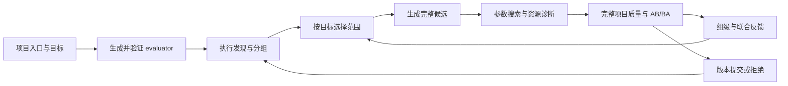

# v6 项目工作流：运行、扩展与结果解释

本页说明已经实现的接口。阶段验收和实际结果见 [验收与边界](v6-acceptance.md)、[执行记录](v6-execution.md)、[验证矩阵](v6-validation-projects.md) 与各阶段 `docs/evidence/`。正式对照的 11 条路径、22 轮已完成；支持某个接口不等于所有模型和目标已经获得加速。

## 模块与迭代位置



| 调整内容 | 实际实现与扩展方式 |
|---|---|
| 项目语义、状态、质量与目标 | `request.py` 和生成的六函数 adapter；`workflow.py`／`variants.py` 验证并冻结。案例源码及资产在框架外。 |
| 理解、选组与候选生成 | `agents.py` 连接真实 provider；`adapter_prompt.md`、`selection_prompt.md`、`candidate_prompt.md` 分开维护；`generated.py` 校验产物。当前 Agent transport 为 OpenCode，替换 transport 仍需实现对应 client 接口。 |
| 发现与归属 | `discovery.py` 捕获 module／functional；`trace.py` 解析原生关联；`aggregation.py` 合并 rank；`communication.py` 处理 collective 和能力探测。 |
| 额外采集后端 | `collectors.py` 的 registry 与 `profiling.collector_plugins`；诊断 collector 提供 `collect(search, revision)`，返回状态、rank 结果和原始证据。目标通信采样单独提供 `metric(...)`，不会把额外诊断当作干净 J。 |
| 执行时序与绑定诊断 | `timeline.py` 提供独立 CPU/CUDA 关联、被动梯度回调、可选 CUDA stream marker 和有界 CPU 时钟对齐；`python_profile.py` 提供独立 cProfile。均通过采集器注册，不增加失败路由或搜索状态机。 |
| 参数与资源响应 | `inner_loop.py` 适配旧 TaskSearch/TPE；新增资源字段声明单位、类型与范围，原单算子搜索无需改写。 |
| 接受与约束 | `measurement.py`／`constraints.py`／`quality_report.py`；统一检查完整项目、原始参考约束、噪声与活动 bundle 覆盖。 |
| 多候选和整版生命周期 | `transactions.py`、`binding.py`、`branches.py`、`versioning.py`；候选声明依赖／替换，整版导入后重新评价。 |
| 搜索策略与恢复 | `search.py` 顺序协调，`experiment.py` 管理可行分支，`experiment_policy.py` 定义对照策略，`recovery.py` 恢复真实会话与已生成制品。 |

采集器可以按配置注册；搜索策略和 Agent transport 目前通过独立 Python 模块替换，不宣称所有模块都已有动态插件加载。调整共同接受规则后，应冻结新代码版本重新测量，避免把新旧规则混入同一对照。

## 从项目入口开始

旧单算子命令保留原默认路径。项目任务使用独立的 `optimize-project`，输入项目源码清单、入口、实际资产、workload、目标、质量标准和设备 UUID，不需要提供算子组或目标算子列表。框架调用实际配置的 Agent 生成 evaluator，再执行完整输出、状态重置、连续步骤及负控制；通过后才发布原始参考。

最小请求结构如下，路径、设备和目标按项目实际填写：

```json
{
  "source_root": "/path/to/project",
  "entry": "inference.py",
  "files": ["inference.py", "model.py"],
  "goal": "minimize latency of the complete declared request",
  "objective": {"name": "latency_ms", "unit": "ms", "direction": "minimize", "paired_repeats": 2},
  "workload": {"batch": 1},
  "quality": {"atol": 0.0001, "rtol": 0.0001},
  "assets": {"weights": "/path/to/weights"},
  "devices": ["GPU-physical-uuid"],
  "communication": "auto",
  "lease_dir": "/path/to/shared-device-leases",
  "warmup": 2,
  "repeats": 5,
  "continuous_steps": 2,
  "worker_timeout_s": 900
}
```

所有并行实验必须使用同一设备 lease 目录。`worker_timeout_s` 是 GPU 作业故障处理条件，不是 Agent/API 使用时限。开发配置可使用 `opencode.request_timeout_s: null`、`idle_abort_frac: 0` 和 `usage.mode: observe_only`；费用、tokens 和请求数只统计。

项目角色的默认 PATH 优先使用 LocalExecutor 的实际 Python 环境；`inputs/worker-environment.json` 提供该解释器、Python 与安装包版本，修复／恢复请求也保留这一事实。Agent 的 CPU/API 检查应使用这里的解释器，避免从另一个 Conda 环境推断实际 worker 的接口。该调整仅作用于项目模式，不修改旧单算子配置或系统安装包。

box4-2 的示例运行方式：

```sh
cd /root/autodl-tmp/dev/opop-v6
export PYTHONPATH="$PWD/src:$PWD"
V6_WORK=/root/autodl-tmp/dev/v6-work
/root/autodl-tmp/dev-venv/bin/python -B -m kernel_optimizer.cli \
  --config "$V6_WORK/configs/box42-v6.yaml" optimize-project \
  --request "$V6_WORK/project-requests/resnet_inference-online-latency.json" \
  --output "$V6_WORK/my-project-run" --rounds 2
```

`--rounds` 和 objective 中的 `parameter_trials` 描述本次显式搜索实验；不会限制一次 Agent 生成过程中的真实请求、自动契约修复或费用。`--prepare-only` 只生成并验证评测，`--discover-only` 再完成发现。`--resume` 要求与原请求完全相同。源码、workload 或目标变化应建立新任务／变体，不能修改已冻结 run 的 request。

## 实现边界与替换接口

生成的 evaluator 提供 `prepare/reset/run/observe/metrics/models` 六个函数；可选 `set_mode` 区分完整正确性输出与原项目干净计时路径，可选 `before_run` 放置源程序定义的计时前协调。模型加载在计时外，候选新增的逐请求计算、通信、同步和转换必须在 workload 内。`observe` 返回完整输出／梯度／更新后参数，不以少量采样或哈希代替。

Torch module 与 functional 调用由实际执行发现，记录阶段、shape、stride、dtype、调用上下文、包含关系和可观察依赖。集合随接受版本重新捕获，旧调用和组显式退休；未知 alias、状态和跨 stream 依赖保留为 unknown。不能把一次 workload 的发现当成所有输入都已覆盖。

候选统一导出 `build(context) -> {call_id: callable}`。context 包含实际 state、models、模块、父实现引用、当前 rank 的目标签名、全部 rank 的目标清单和参数值。模块替换保持原 forward 参数；functional 替换保持该 torch operator 参数；`project.invoke` 替换整个 `run(state)`。同一模块的 prefill/decode 替换由阶段及签名守卫组合。

支持四种 scope：`group`、`joint`、`region`、`execution_plan`。联合候选无需每个子编辑先独立获益；整个候选必须合法且通过项目评价。多个 bundle 可以同时安装，重叠写入必须显式 `replaces`，依赖通过 `requires` 声明。每个活动 bundle 的覆盖只在实际质量 workload 中计数，构建、自测、reset 和 observe 不会满足覆盖要求；外层 Graph 绕过旧 bundle 时必须退役／重构它，不能仅保留旧身份。

目标参数空间交给原有 TaskSearch/Optuna TPE；项目适配器执行完整项目并检查原始基线约束。候选筛选后，新的进程运行 AB/BA；每一对收益都须超过其 MAD 噪声界限。约束固定相对原始参考，不随较差父版本漂移。比较的是完整版本，逐组独立因果收益在未做子项对照时保持 unknown。

有参数空间时默认另跑诊断，使用框架生成的替换范围和原生 launch correlation 采集实际内核、寄存器／线程、共享内存、启动数及诊断时长。`profiling.parameter_resources: false` 可关闭这项额外采集。资源响应只使用带单位、类型与范围的资源字段；不把目标分数、吞吐量或 workload 常量自动标成资源。附加指标通过 `profiling.resource_metrics` 声明元数据。响应是筛选端点的有限差分，不能直接当作因果敏感度或接受证据；完整版本仍须独立 AB/BA。

每个 bundle 的原始站点与实际替换内核保留单独映射；记录不会把已退休 functional 调用重新伪装成当前执行节点。嵌套工作、父实现回退、异步延后执行和缺少关联的 backward 分别说明；没有观测到的归属保持 unknown。Torch/Kineto 某些版本不能正确转义 range 名称中的引号，框架使用可逆编码的标签，原始解析失败回执仍保留。

上一轮失败的实现并不位于已接受版本源码中。框架从已保存的制品读取原候选和原始 targets，作为 `inputs/previous-candidate/` 附件传入选组／候选角色；manifest 记录原身份、用途和不可获取的文件。当前组仍以新 discovery 为准。外部补充事实放在反馈的 `supplemental_evidence` 字段，连同来源与不确定性保存；完整反馈视图保留该字段，仅项目分数对照视图不包含它。

## 冻结候选、变体和探索分支

`--reuse-evaluator ORIGINAL_RUN` 创建目标／workload 变体：评测代码和源文件保持冻结；真实 Agent 只更新契约中的维度、目标、指标口径和约束描述，然后重新生成参考并执行控制。它不会为了通过保留集而修补 evaluator。

`--replay-from SOURCE_RUN --replay-bundle BUNDLE_ID` 在目标 run 上评测原候选，代码和参数不变，只绑定当前已发现的同一 call 身份和签名。不能映射的调用明确返回不支持，不按名称猜测替代站点。默认只产生 exploration 结果；`--publish-replay` 也必须通过独立配对评价。

`--resume-trial TRIAL_ID` 可复用已提交的 `generated.json` 制品，无需再次调用生成 Agent，要求父版本完全相同。原始失败、调用回执、候选字节和每次独立测量均保留。中断后的已存在作业目录应保留，不用删除目录或覆盖历史来制造“成功重跑”。

`--branch-from RUN [--branch-revision REVISION]` 建立隔离实验。可从已测量、质量与约束通过但未改善的候选继续搜索；不会改动源 run 的已接受指针。引用的原始正确性 tensors 只读共享，候选文件、事务和索引独立。分支上的接受只表示相对分支父版本通过，不能直接宣称优于源 run 的最优版本；推广回主版本前须完整重新比较。

`--search-strategy bounded_joint --frontier-width 2 --rounds 4` 在主路径与可行探索分支之间交替提案。质量／约束通过但单步较慢的候选可成为分支父版本；前沿按目标保留，并优先访问尚未探索的分支。它不要求各子候选单独加速。状态位于 `experiments/<id>/experiment.json`，使用同一 `--experiment-id` 和协议可恢复中断轮次，复用原会话或生成制品。默认 `sequential` 保留原项目顺序策略。

`--promote-from BRANCH [--promote-revision REVISION]` 导入完整快照及所有活动 bundle 的原始字节、参数、顺序和依赖，重新对比当前主版本。每个测量端点检查每个 rank 上所有活动 bundle 的哈希及实际调用覆盖，通过质量、原始约束、AB/BA 收益与源码一致性检查后才原子提交。分支收益和整体收益分别留档，未测独立贡献标为 `joint_only`。

`--resume-generation RUN/sandboxes/<role-id>` 在原 provider session 中继续被中断的 selection/candidate；不会重建一个假会话。实际 HTTP 429 或临时服务错误会触发共享冷却及自适应并发排队，成功后逐步恢复并发，不设置重试次数、费用、token 或调用总量限额。候选失败与 provider 故障分别记录。数值错误反馈包含连续步骤、观察张量路径和固定阈值；“比较遍历中的首个失败”不等同于最早执行分歧。继承候选未执行会单独报告，不冒充数值错误。

429 也可能是 provider 账户窗口耗尽。运行时保留可用于调度的完整错误字段，队列遵循实际 `Retry-After` 或明确恢复时间；未带时区的消息会记录采用的宿主时区。该等待来自服务端可用性，不能与开发费用／调用额度混同。已有会话保留；若账户设置已改变，应先核实服务端状态再重新检查队列，不能将外部限制当成已完成的候选轮次。

## 通信和其他资源

`communication=auto` 仅在当前任务包含多卡时启用通信维度；`off` 关闭额外通信采集；`required` 配合 `required_observations` 声明缺失时必须失败的字段。设备数由任务实际绑定决定，机器有两张卡但任务只用一张时不应声称发生跨卡通信。

采集层提供可替换 registry，`profiling.collector_plugins` 使用 `name -> module:factory` 注册实现。内置 Torch 通信采样与 Nsys 分离运行；工具路径由配置／环境探测提供。真实 Collector Agent 根据已观察能力选择采集，硬件计数器不可用时记录原因，仍可获取基础 CUDA/NVTX trace。缺失值不填零。

`device_telemetry` 通过只读 NVML API 探测当前 UUID 上可用的 PCIe TX/RX、设备活动比例与设备显存，并在单独的 workload 窗口采样。PCIe 返回原生 KB/s，属于约 20 ms 窗口的速率，不能再次差分；每次 API 读取可能阻塞，保存实际读取起止时间而不假定精确固定采样频率。NVLink 仅读取可发现链路的单位／过滤器和已有累计计数，不配置或重置计数器，API 缺失／不支持时保留原因。[NVML 设备查询语义](https://docs.nvidia.com/deploy/nvml-api/latest/api/group__nvmlDeviceQueries.html)

`collective_calibration` 从真实 trace 提取完整参与者的 SUM allreduce 消息大小／dtype，在独立诊断作业验证合成数据归约并测量完成时间。其他 collective、未知 reduction 或子组保持不支持，插件可扩展。逻辑 payload 除以完成时间只是有效逻辑速率，不是物理链路吞吐或模型调度的性能下界。

| 字段 | 可解释范围 |
|---|---|
| module/functional/phase CUDA 时长 | 诊断归属；嵌套范围重叠，不能相加当端到端收益 |
| kernel grid/block/registers/shared memory | 已观察 launch 配置；不是实测 occupancy 或内存总线流量 |
| collective identity、participants、logical payload | 实际调用与逻辑 tensor 字节；不是 PCIe/NVLink wire bytes |
| NCCL kernel sum、interval union、compute overlap | 本 rank 的观测时间区间；包含等待，不等于因果关键路径或纯传输时间 |
| 梯度存储与 bucket/参数/调用关联 | 存储区间、实际参数别名和 launch 证据一致时可确定；不能解析的自定义压缩／搬运保持 unknown |
| warm-run allocated、reserved | PyTorch allocator 指标，明确区分已分配与保留池 |
| lifecycle peak allocated/reserved | 包含模型准备、候选安装、Graph capture 及后续调用的 allocator 峰值；不包含非 PyTorch 驱动分配 |

box4-2 实测为无 P2P、无 NVLink 的双 4090，NCCL 使用 SHM/direct/direct。NVLink/RDMA 场景仍需相应硬件验证。plain Torch profiler 对 DDP 的 wall time 也有明显扰动；通信目标标为 diagnostic，另用干净 step 指标约束。重插桩发现 trace、独立通信采样和干净 wall time 不得互换。

## 可复现的策略对照

`examples/v6_validation/run_comparison.py` 从同一已发现原始版本创建分支：`whole` 允许全部范围，`leaf` 只允许叶算子单组，`score_only` 保留项目指标与正确性反馈但去除分组／资源响应解释，`local_time` 按最大已测叶组 CUDA 时长选择，再调用真实候选 Agent。每条路径固定同样的候选轮数、参数试验上限、质量和采样协议，保存实际成本和所有失败。API 调用次数不设限；因此这是同实验协议对照，不是声称所有路径实际消耗完全相同。

等协议比较至少运行两轮，才能检验反馈效果。worker 记录实际框架源码哈希；同一 AB/BA 组混用不同框架版本时拒绝接受。框架的 UUID lease 避免自身作业竞争，同时观察外部 CUDA 客户端；发现干扰则丢弃样本。进程快照有采样间隔，仍不能替代硬件级独占环境。

已生成的两个候选可以用 `examples/v6_validation/run_interaction.py` 单独做组合归因实验。输入原始 run、A/B 的 run 与 bundle、完整组合 run 与 revision，以及新的输出目录；脚本检查子项没有未满足依赖、替换或写冲突，保留原代码与参数，分别将 A、B、A+B 和同一个冻结父版本做独立 AB/BA。质量失败、源码不同或缺少测量时，交互保持不可解释。`gain(A+B)-gain(A)-gain(B)` 只描述已测组合，极值与 MAD 扩展范围不是统计置信区间，也不将共享效果分给某个组。默认不提交这些诊断版本；依赖另一子项才能合法运行的组合返回不可独立拆分，不强行制造单项收益。

## 当前验证边界

后续组合退化调查增加了 `execution_timeline` 和 `python_runtime` 两个可选采集器。前者在 profiler 初始化后、标记的 workload 开始前完成 rank 准备；只统计 workload 窗口内的操作。CPU 提交时间通过本机 monotonic 时钟锚点给出区间，不将其解释为 GPU 到达时间。梯度 post-accumulate 回调同样是 CPU 证据；`profiling.execution_timeline.gpu_gradient_markers=true` 可在诊断中额外记录当前 CUDA stream 的事件，不添加逐参数 synchronize。事件本身有扰动，且并不独自证明 bucket 输入就绪或消费完成。后者的累计 CPU 时间包含等待，也不能与 GPU 时间相加。

`examples/v6_validation/run_binding_ablation.py` 对已有候选执行不发布的完整质量和 AB/BA 诊断：原始 revision 的直接/框架空载对照，以及相同父版本的新增站点透传/实际候选对照。透传保持站点绑定但跳过新增候选 build 和计算；它测得的是“接入绑定路径”的差异，不能假设底层 kernel 图完全不变。Qwen 实测透传出现原阈值内的数值差异，因此不能把全部退化称为纯 Python 开销。

`examples/v6_validation/run_timeline_comparison.py` 在相同原始候选上分别采集无梯度回调及有回调的时间线，保留 profiler 扰动和所有未知项。这些诊断是显式发起的验证工作，不计为新自主搜索或候选收益。具体结果及此前自动化证据范围见 [复核记录](v6-autonomy-audit-and-followup.md)。

`candidate_diagnostics` 采集器在独立 worker 中跟踪候选安装和连续执行，记录被吞掉的 Python 异常、返回 False 的条件及最近源代码行，不读取局部变量或保留 tensor。它可以通过 `collect_extra` 显式调用，也会在参数筛查观察到任一 rank 上该 bundle 的任一活动站点全部经过 `context.references` 时自动采集，并进入下一轮完整反馈。触发回执列出对应 rank、bundle、call 和调用数，因此联合候选中部分融合成功、另一部分始终回退也能进入诊断。`profiling.candidate_diagnostics` 可设为 `off`、默认的 `on_reference` 或 `always`。引用原实现也可能是合法组合的一部分，触发诊断不等于判定候选无效；异常和 False 条件也必须结合源代码解释。追踪范围为当前 Python 线程的候选安装文件，不覆盖 native kernel、其他线程或导入的辅助文件；其计时不参与接受规则。

选组／候选角色同时获得 `inputs/binding-contract.md`，说明安装阶段与实际 adapter 调用的 phase／dispatch 区别，以及 Graph 原生执行不能直接用 Python hook 数量解释。完整定义保存在 [组合执行契约](../src/kernel_optimizer/project/binding_contract.md)；它覆盖新生成、同会话修复和恢复，不要求每个任务自行添加这一上下文。

项目请求可设置 `binding_backend: scoped`，默认仍为 `legacy`。只有所有实际安装的
functional 站点都有可解析模块边界时，scoped 才在相应模块内启用分派；缺少边界或
存在多个 functional bundle 时沿用 legacy。安装回执和下一轮 `binding_execution`
反馈包含请求后端、实际后端和原因。它不是无条件加速开关：整个模型都属于同一
作用域时仍可能承担大部分分派开销。`run_binding_backends.py` 可在相同候选上做
不发布的交替后端比较。

额外 Collector 输出现在作为 `inputs/observations/current/` 的完整 JSON 附件提供，
索引记录内容哈希、revision、目标、设备和采样窗口。进入配对评价且通过质量与覆盖的候选还会重跑
Collector Agent 已选择的采集器；下一轮在 `observations/previous-before/` 和
`observations/previous-after/` 获取前后观测。共享参数和 bucket 的所属关系另提供
导航索引，保留多对多关联，不把共享通信时间直接分摊为逐组贡献。完整附件可由 Agent
自行查询，没有新增按失败类型限制信息获取的规则。

`examples/v6_validation/run_autonomous.py` 用全新输出目录验证完整入口：生成 evaluator、
独立源程序输出核对、发现和采集选择、至少两轮真实搜索及反馈。独立 oracle 位于验证
示例中，不是核心框架对模型的特化。脚本的 `completed` 表示实验轮次结束；仍需检查
每轮错误、质量、覆盖、约束、接受结果和源码一致性，不能把它直接计为优化成功。
冻结六任务的协议和开发失败见 [本阶段记录](v6-stage2-binding-and-autonomy.md)。

真实任务包含 ResNet-18、Qwen3-4B、GPT-2 DDP，以及在核心初版后接入的纯函数信号项目。DDP 的随机权重和合成 token 是明确声明的工作负载，只验证参考计算一致性，不声称训练收敛或语言能力。具体成功、失败、无改善、shape 守卫回退和未测硬件分别报告。

框架不承诺任意项目自动获得加速。当前重点是实测闭环：真实理解与生成、自动发现、按目标选择、完整回装、质量与状态校验、资源反馈、拒绝与恢复，以及明确的证据归属。进一步训练时序、不同 rank 上同路径不同语义、特殊自定义 runtime 和更复杂别名关系需要扩展对应适配／采集能力。
